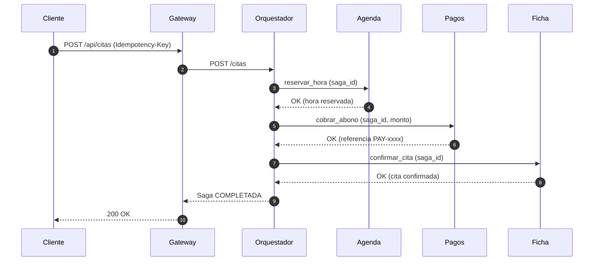
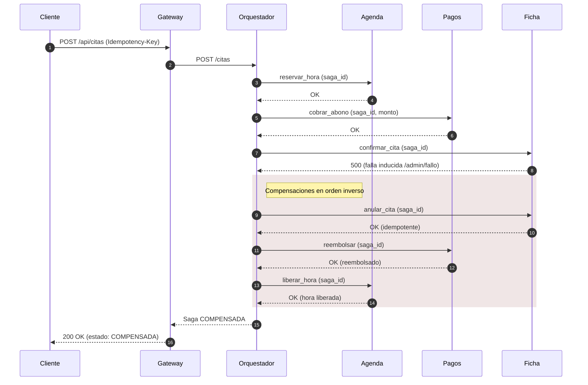
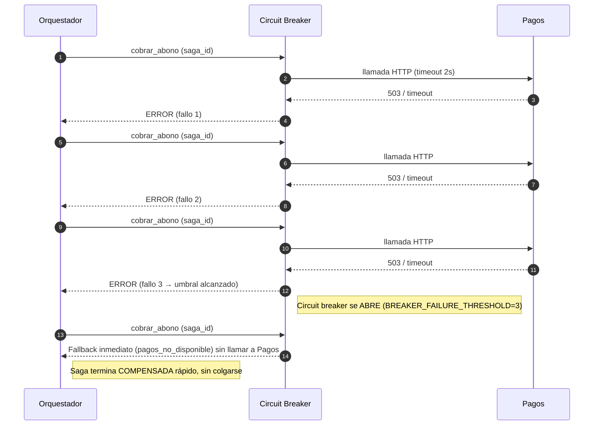

# Diagramas de arquitectura (Mermaid)

A continuación se presentan los diagramas de secuencia de los escenarios principales del sistema.

## 1. Flujo feliz — camino exitoso de la Saga

.png)

## 2. Fallo en Ficha con compensación inversa

## 3. Circuito abierto en Pagos (resiliencia)

.png)

## 4. Bulkhead (aislamiento de recursos)

El Bulkhead limita las llamadas concurrentes a Pagos mediante un semáforo acotado (`BULKHEAD_MAX_CONCURRENT=5`). Si se excede el cupo, se rechaza inmediatamente para que una dependencia lenta no agote los hilos del Orquestador y el resto del sistema siga funcionando.

---
